## 一句話結論

ReVanced 的 Spoof video streams 用咗 `Android Reel (no auth)` 做預設 client。
播放中途，YouTube 開始對播放器每一個新 byte-range 請求回 HTTP 403（`er.2004`），
ExoPlayer 當成可重試錯誤，一路 retry，所以畫面凍結但唔會出 loading spinner。
有時更會卡在 480p，揀唔到更高。
將 client 改成 `visionOS` 之後，同一網絡、同一部機、同一條片，403 次數變成 0。

---

## 症狀

- 開片正常，播大約一分鐘（或四分之一）之後停住。
- 拉時間軸、或者連續「跳跳跳」之後，卡住好長時間。
- 卡住時冇 buffering spinner，只有靜止畫面。
- 有時自動得 480p，畫質選單揀極都轉唔到。
- YouTube 同 YouTube Music 都有同樣情況。

## 環境

| 項目 | 值 |
|---|---|
| 裝置 | Google Pixel 9a (tegu) |
| 系統 | Android 17 |
| Profile | Daily（Android user 11） |
| YouTube | ReVanced 20.40.45 |
| YouTube Music | ReVanced 8.40.54 |
| ReVanced Patches | 6.2.1 |
| ReVanced Manager | 2.6.0 |
| microG | 0.3.13.2 |
| 網絡 | Wi-Fi，5 GHz，`VALIDATED` |
| Private DNS | `dns.adguard-dns.com` |
| VPN | 未啟用 |

## 版本記錄

全部由 `adb shell dumpsys package <pkg>` 及 App 內 `ReVanced → About`
取得（2026-11-27 14:50 HKT）：

| 套件 | versionName | versionCode | 狀態（Daily） | 備註 |
|---|---|---:|---|---|
| `app.revanced.android.youtube` | 20.40.45 | 1557278144 | 啟用 | 今次實際使用的 YouTube ReVanced |
| `app.revanced.android.apps.youtube.music` | 8.40.54 | 84054240 | 啟用 | YouTube Music ReVanced |
| `app.revanced.android.gms`（microG） | 0.3.13.2.250932 | 250932004 | 啟用 | ReVanced 簽名登入 |
| `app.revanced.manager.flutter`（ReVanced Manager） | 2.6.0 | 200600099 | 已安裝 | patch 管理 |
| `com.google.android.youtube` | 21.47.483-**EXTENDED** | 1561317014 | **停用** | RVX（ReVanced Extended）build，非原廠 |
| └ 系統 factory 版本 | 21.18.164 | 1561170057 | — | 未啟用 |
| `com.google.android.apps.youtube.music` | 9.35.54 | 93554240 | **停用** | 原廠 YouTube Music |
| └ 系統 factory 版本 | 9.10.52 | 91052240 | — | 未啟用 |
| **ReVanced Patches** | **6.2.1** | — | — | YouTube 及 YouTube Music 共用 |

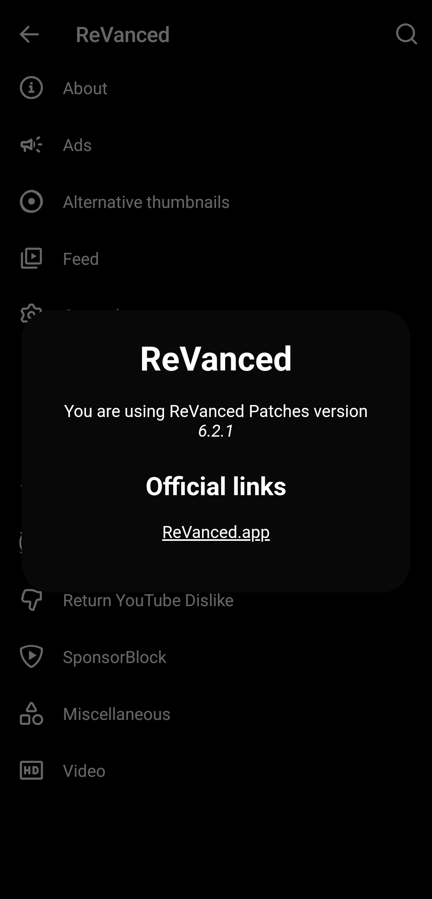

*Captured 2026-11-27 14:50 HKT*

注意：`app.revanced.android.youtube` 的 base 係 20.40.45，落後於原廠
21.x；呢個舊 base 配上 Patches 6.2.1，client 名單就只有
Android Reel / Android Reel (no auth) / Android Studio / Android VR / visionOS。
`com.google.android.youtube` 的 `21.47.483-EXTENDED` 係另一個 RVX build，
Daily profile 冇啟用，所以今次唔關它事。

## 重現方法

1. 開任何一條片。
2. Double-tap 畫面右邊（+10 秒）連續 5–6 次，或拖動 seek bar。
3. 片段會凍結，但不會顯示 loading。

用 `adb logcat` 睇到：

```bash
adb logcat -v time | grep -E 'YT\.qoe|mlplayer|rc\.403'
```

## 證據：logcat 裡面的 403

失敗時，YouTube 的 QoE log 會不斷出現：

```text
error=25.281:net.badstatus::56.056:pos.1058068;len.177830;loaded.0;
trk.1;fmt.251;rc.403;er.2004;rn.40;
shost.rrN---sn-xxxx.googlevideo.com;
m.Response code 403
```

| 欄位 | 意思 |
|---|---|
| `rc.403` | googlevideo 回的 HTTP status code：403 Forbidden |
| `er.2004` | googlevideo 的串流錯誤碼 |
| `net.badstatus` | player 將它分類為「網絡回應狀態錯誤」 |
| `rn.40` | 已重試 40 次（之後繼續升） |
| `fmt.251` / `fmt.397` | itag：251 = Opus 音訊，397 = AV1 影片 |
| `pos` / `len` | 請求的 byte range 起點與長度 |
| `shost` | 出事嘅 CDN host，全部都係 `*.googlevideo.com` |

每一次 retry 都是同一個 403。播放器不斷重試，拿不到新數據；
ExoPlayer 仍在「重試」而不是「buffering」，所以 UI 不會顯示 loading spinner。

## 根因

### YouTube 的播放流程

YouTube 不是直接給播放器一條固定的 MP4 URL。流程係：

1. 播放器向 YouTube API 拿「player response」，裡面有**已簽名的 googlevideo URL**。
2. 播放器用 `Range: bytes=…` 分段下載。
3. 每次 seek、每次跳段，播放器都會用新 range 再向 `googlevideo.com` 拿資料。

所以一條 URL 被拒，不會在開頭就出事，而是在下一個 range request 才出現問題。

### ReVanced 的 Spoof video streams

ReVanced 的 `Spoof video streams` patch 會用另一個「client 身份」向 YouTube 拿串流資料，
令播放器避開廣告與 client 限制。問題係揀錯 client：

- 當時設定：`Spoof video streams → Default client: Android Reel (no auth)`
- 這個 client 給出的串流 URL／格式，YouTube 之後拒絕（403 `er.2004`）。
- patch 自己的設定頁都寫明副作用：
  > *Spoofing side effects: Video may stop at 1:00, or may not be available in some regions.*
- 畫質同樣受影響：選 1080p 會產生新的 URL，一樣 403，所以最後停在 Auto 480p，
  畫質選單看起來「揀唔到」。

### 一句講完

> 問題不在網絡。ReVanced 用來扮的 client（Android Reel (no auth)）被 YouTube 以 403 拒絕；
> 播放器收到 403 後不停 retry，所以卡住但唔 loading。

## 修復

YouTube 同 YouTube Music 的路徑一樣：

1. 開 App → 右上角頭像 → **Settings**。
2. 進入 **ReVanced → Settings**（YouTube Music 係 Settings → ReVanced）。
3. 右上角搜尋 `spoof`。
4. 打開 **Spoof video streams → Default client**。
5. 由 `Android Reel (no auth)` 改成 **`visionOS`**。
6. 完全關閉 App 再開（`adb shell am force-stop <package>`）。

### 修復前

YouTube 的 `Spoof video streams` 當時用 `Android Reel (no auth)`：

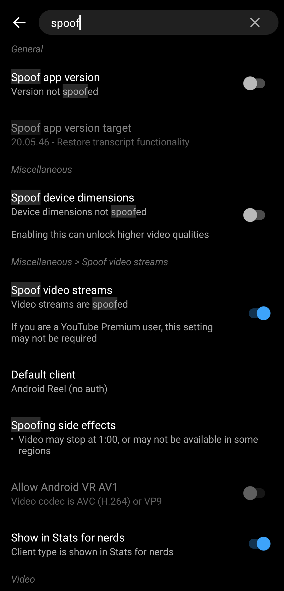

*Captured 2026-11-27 14:39 HKT*

可選 client 一覽（Android Reel / Android Reel (no auth) / Android Studio / Android VR / visionOS）：

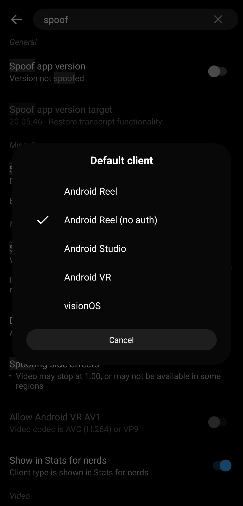

*Captured 2026-11-27 14:39 HKT*

### 修復後

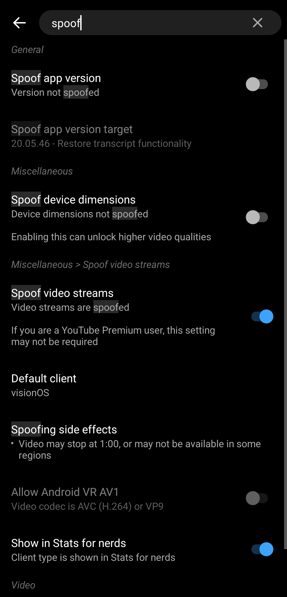

*Captured 2026-11-27 14:39 HKT*

畫質選單由「只得 480p」變成 2160p / 1440p / 1080p / 720p / 480p / 360p / 240p / 144p：

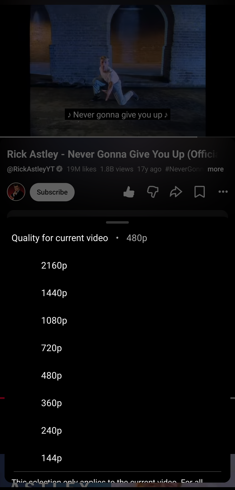

*Captured 2026-11-27 14:41 HKT*

## 驗證

| 測試 | 修復前 | 修復後 |
|---|---|---|
| 連續 skip（3 輪 × 6 次 double-tap） | 多次 `rc.403`，重試 `rn` 升到 72 | **0 次 `rc.403`** |
| 54 分鐘長片 | 跳段後出現 `rc.403`、不停重試 | 正常播放，跳段後繼續 |
| 畫質選單 | Auto 480p，轉唔到 | 清單有 2160p，可選 1080p |
| YouTube Music 拖 seek bar 3 次 | 4 組 `rc.403`，`rn` 73→91 | **0 次 `rc.403`** |
| YouTube Music 下載 + 離線播放 | 之前下載失敗 | 下載成功（5→6 首），關 Wi-Fi／數據仍可播，0 次 `rc.403` |

修復後長片播放中：

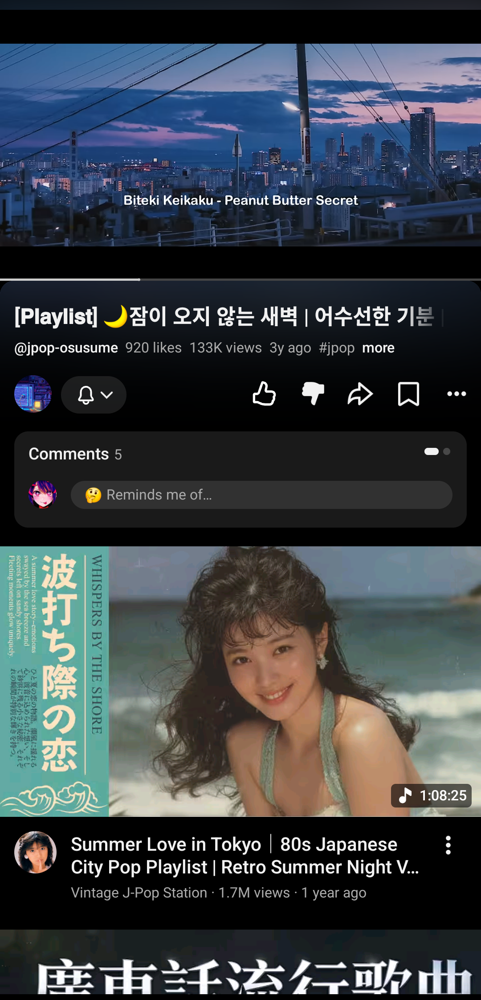

*Captured 2026-11-27 14:42 HKT*

## YouTube Music：同一個根因

YouTube Music ReVanced 8.40.54 一樣有 `Spoof video streams`，預設同樣係
`Android Reel (no auth)`：

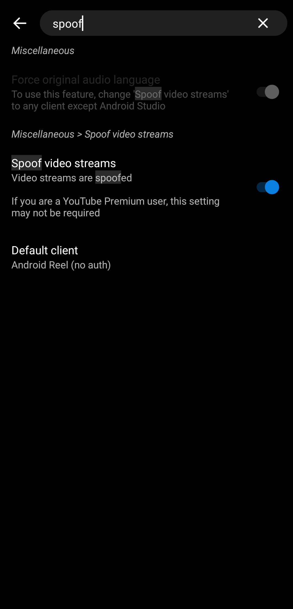

*Captured 2026-11-27 14:46 HKT*

拖動 seek bar 之後，logcat 出現同一款錯誤（`fmt.397`、`fmt.251`、`rc.403`、`er.2004`）：

```text
error=48.449:net.badstatus::175.858:pos.931238;len.150996;loaded.0;
trk.2;fmt.397;rc.403;er.2004;rn.73;
shost.rrN---sn-xxxx.googlevideo.com
```

改成 `visionOS` 後：

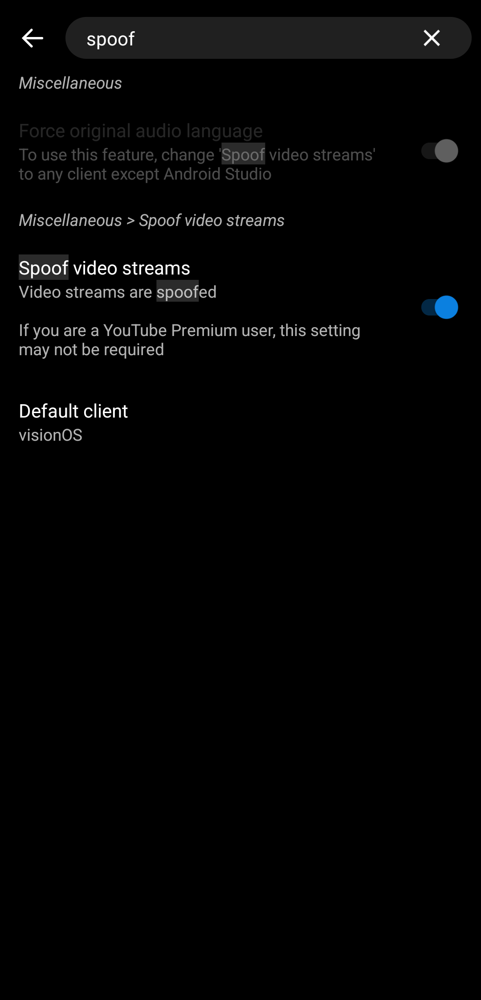

*Captured 2026-11-27 14:48 HKT*

再拖 seek bar 3 次：0 次 `rc.403`，播放正常。

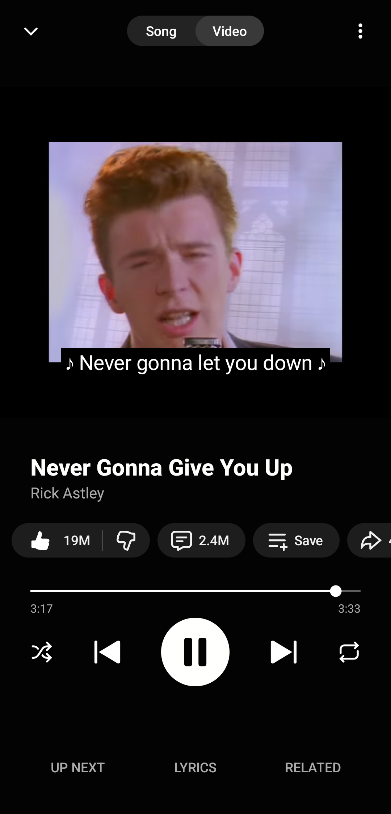

*Captured 2026-11-27 14:48 HKT*

## YouTube Music 下載：同一個 403 的副作用

之前下載唔 work。改用 visionOS 之後實測，下載正常：

- Settings → Downloads and storage：57 MB used / 31.76 GB free，
  Audio quality = Normal，Video quality = Audio only if available，
  「Recently played songs」自動下載開著。
- 歌 → ⋮ → Download → 完成（✓）。
- 再下載第二首（《花になって》），Downloaded songs 由 5 首變 6 首。
- 關掉 Wi-Fi + 流動數據，由 Downloads 播放：正常播到 0:08 / 3:19。
- 整個下載 + 離線播放期間，logcat `rc.403` = 0。

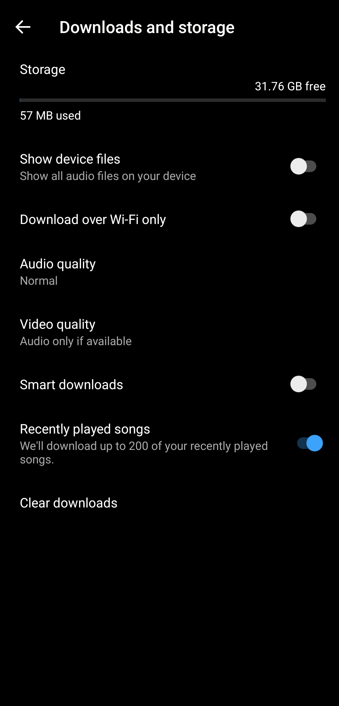

*Captured 2026-11-27 14:52 HKT*

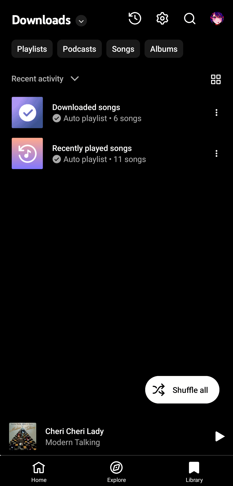

*Captured 2026-11-27 14:53 HKT*

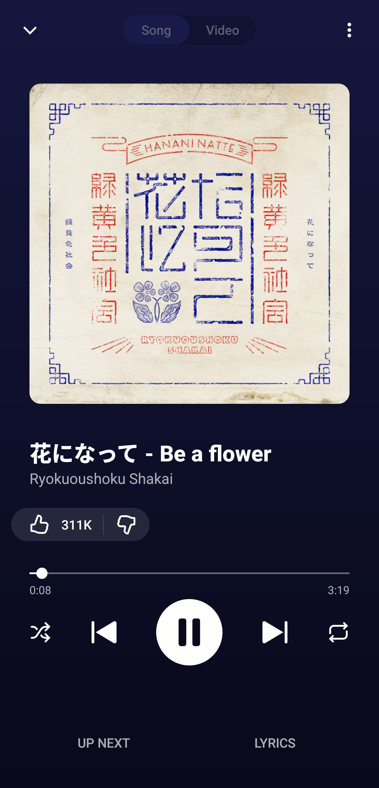

*Captured 2026-11-27 14:54 HKT*

下載同串流都用 googlevideo；client 被 403 時，下載亦拿不到資料，
所以好大機會係同一個根因。若某個特定 playlist / album 仍然失敗，就要再單獨查。

## 不是這些原因

- **AdGuard Private DNS**：DNS 正常解析（`redirector.googlevideo.com` → `142.250.x.x`），
  403 是 Google 回覆的，不是 DNS 攔截。而且改 client 後，同一 DNS 設定下就恢復。
- **Wi-Fi / ISP**：同一 Wi-Fi、同一時間，改設定前後，403 由有變冇。
- **儲存空間**：`/data` 仍有 32 GB 空位。
- **Codec / 硬件解碼**：解碼器正常出畫面（`c2.exynos.h264.decoder` / AV1），
  問題發生在取得資料之前。
- **VPN**：裝置上 VPN 未啟用（手機上 WireGuard app 存在但沒有連線）。

## 如果再次發生

1. 先試 `visionOS`；唔得再試 `Android VR`。
2. 仍然 403 就試 `Android Studio`。
3. 全部 client 都失效，代表 ReVanced patch 落後，需要更新 ReVanced patches / app。
4. 先睇 logcat 有冇 `rc.403`；不要改 DNS、重裝 App 或清資料。

## 附錄：用到的 adb 指令

```bash
# 看目前播放狀態
adb shell dumpsys audio | grep -E 'AudioTrack.*state:(started|paused)'

# 睇 ReVanced / YouTube 的播放錯誤
adb logcat -v time | grep -E 'YT\.qoe|mlplayer|rc\.403|badstatus'

# 重開指定 app
adb shell am force-stop app.revanced.android.youtube
adb shell am start -a android.intent.action.VIEW \
  -d 'vnd.youtube:VIDEO_ID' -p app.revanced.android.youtube

# YouTube Music
adb shell am force-stop app.revanced.android.apps.youtube.music
adb shell am start -a android.intent.action.VIEW \
  -d 'https://music.youtube.com/watch?v=VIDEO_ID' \
  -p app.revanced.android.apps.youtube.music
```

---

*Last updated: 2026-11-27 14:56 HKT*
